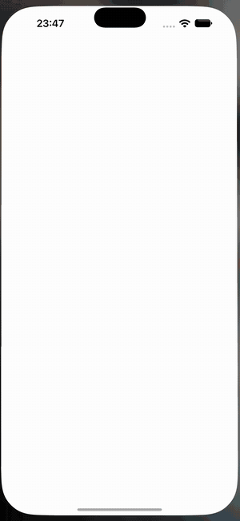
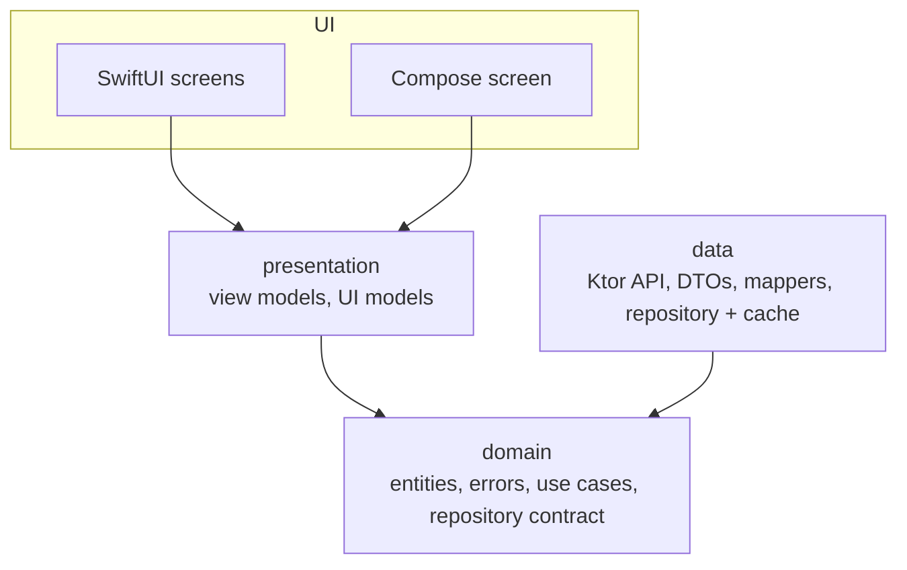

# KMP iOS Integration Demo

A **test project that demonstrates how to integrate Kotlin Multiplatform (KMP) into an iOS app**.
It is a small Rick & Morty browser: networking, business logic, error handling and state live in a shared Kotlin
module, and the iOS app (SwiftUI) renders that state. A second tab renders the *same* state with Compose
Multiplatform to compare both UI approaches.

The goal is to show the real integration process and its pitfalls, not to be a production app.

<p align="center">
  
</p>

The recording shows the SwiftUI list loading from the shared module, scrolling, the detail screen (served from the
already loaded data), and the Compose tab rendering the same state.

## What it demonstrates

- A shared Kotlin module consumed by a native iOS app as a framework.
- **Two interop variants of the same app**, to compare side by side:
  - `iosApp-Plain`: plain Kotlin/Native to Objective-C export, no extra tooling.
  - `iosApp-SKIE`: identical Kotlin code built with [SKIE](https://skie.touchlab.co/).
- Clean Architecture inside the shared module (domain, data, presentation).
- Typed error handling for every endpoint, covered by unit tests.
- Data that is independent of screens: one repository owns it and every screen observes it.
- Ktor, kotlinx.serialization, coroutines and `StateFlow`, kotlinx-datetime, `kotlin.uuid.Uuid`, `expect`/`actual`.
- Kotlin enums and sealed types crossing into Swift, and Compose Multiplatform hosted inside SwiftUI.

## Architecture



Dependencies point inwards. The domain layer knows nothing about Ktor, JSON or UI. Domain and data are `internal`, so
Swift sees only `AppContainer`, the two view models, their UI state and UI models; the generated Objective-C header is
roughly half the size it would be with everything public.

```
shared/src/commonMain/kotlin/pet/shared/
├── domain/
│   ├── model/        CartoonCharacter, CharactersSnapshot, enums
│   ├── error/        DomainError (sealed), Outcome<T>
│   ├── repository/   CharacterRepository (interface)
│   └── usecase/      Observe / LoadNextPage / Refresh / GetCharacter
├── data/
│   ├── remote/       CharacterApi, DTOs, HttpClient setup, safeApiCall (exception -> DomainError)
│   ├── mapper/       DTO -> domain
│   └── repository/   CharacterRepositoryImpl (single source of truth)
├── presentation/
│   ├── characters/   CharactersViewModel + UI state
│   ├── detail/       CharacterDetailViewModel + UI state
│   ├── model/        CharacterUi, ErrorUi and mappers (display strings are prepared here)
│   └── compose/      Compose Multiplatform screen
├── di/               AppContainer (manual DI; the app creates one and passes it down)
└── platform/         expect/actual example
```

### Data independent of screens

`CharacterRepositoryImpl` holds the loaded characters in a `StateFlow`, and the container creates one instance for the
whole app. View models are thin and own no data. You can see the effect in the app:

- A character detail screen is served from the loaded list, with no extra request.
- The Compose tab shows the list immediately; it does not reload.
- Recreating a view model, or a whole screen, never loses data.

### Error handling

Every endpoint goes through one path: `safeApiCall` converts any exception into a typed `DomainError`, and the
repository returns `Outcome<T>` instead of throwing, because exceptions are awkward to consume from Swift.

| Situation | DomainError | UI behaviour |
|---|---|---|
| No network, DNS or TLS failure | `NoConnection` | message + Retry |
| Timeout | `Timeout` | message + Retry |
| HTTP 404 | `NotFound` | message, no retry |
| Other HTTP 4xx | `RequestRejected` | message, no retry |
| HTTP 5xx | `ServerFailure` | message + Retry |
| Undecodable body | `InvalidResponse` | message, no retry |
| Anything else | `Unknown` | message + Retry |

- Every request carries a generated `X-Request-Id` (`kotlin.uuid.Uuid`). The id is part of each `DomainError` and is
  shown on error screens, so a failure can be traced.
- HTTP status codes are interpreted in the data layer only; the domain and everything above it have no HTTP concepts.
- A 404 for a page past the end of the list means "no more data", not an error.
- A failed next page keeps the loaded list on screen and shows a non-blocking error; a failed refresh keeps old data.
- Unknown enum values from the server fall back to `UNKNOWN` instead of failing the whole response.
- Cancellation is always rethrown so coroutine cancellation keeps working.

Endpoints: `GET /character?page={n}` and `GET /character/{id}` from <https://rickandmortyapi.com>.

## Design decisions and trade-offs

- **Layers are packages in one Gradle module.** iOS consumes a single framework. Separate `:domain`, `:data` and
  `:presentation` modules are possible, but every module Swift needs must then be re-exported from an umbrella framework.
- **Manual dependency injection.** `AppContainer` is a plain class: the app creates one and passes it down, and tests
  inject a fake repository through its internal constructor. A DI framework would add more than this size warrants.
  Passing the whole container to screens is closer to a service locator; handing each screen only its view model would
  be stricter.
- **`Outcome` instead of exceptions** at layer boundaries, so Swift never has to catch Kotlin exceptions (which only
  cross the boundary when marked `@Throws`).
- **Small public surface.** Everything except what Swift needs is `internal`.
- **Both interop variants are kept** to show what SKIE actually buys. Each Swift model file is short enough to compare.
- **Error mapping is tested with a mock HTTP engine.** The mapping covers the exceptions Ktor documents, but failures
  produced by the real Darwin engine are not covered by integration tests.

## Running it

Requirements: macOS, Xcode and a JDK. Developed and verified with Xcode 27, JDK 24 and the Kotlin and Gradle versions
pinned in `gradle/libs.versions.toml` and `gradle/wrapper/gradle-wrapper.properties`. Android Studio is optional but
convenient for editing Kotlin.

```bash
open iosApp/iosApp.xcodeproj
```

Pick the `iosApp-Plain` or `iosApp-SKIE` scheme and run on a simulator. Xcode calls Gradle through a Run Script phase
(`embedAndSignAppleFrameworkForXcode`), which builds the Kotlin framework first. The first build is slow because
Kotlin/Native downloads its toolchain.

The Xcode project is generated from `iosApp/project.yml` with [XcodeGen](https://github.com/yonaskolb/XcodeGen) and
committed. After changing `project.yml` or adding Swift files, run `xcodegen generate` inside `iosApp/`.

### Tests

```bash
./gradlew :shared:iosSimulatorArm64Test
```

The suite runs on the iOS simulator. It covers every error type for both endpoints, repository behaviour (pagination,
de-duplication, refresh, caching, overlapping loads), view model states and the dependency container. HTTP is mocked
with Ktor's `MockEngine`; view models are tested against a hand-written fake repository.

### Switching variants

The variant is a Gradle property (`-Pskie=true|false`) set by each target's Run Script. Each variant builds into its own
directory (`shared/build` and `shared/build-skie`).

## Where to look to understand the interop

| Topic | File |
|---|---|
| How Kotlin becomes a framework (targets, framework name, SKIE switch) | `shared/build.gradle.kts` |
| What Swift actually sees | `shared/build/bin/iosSimulatorArm64/debugFramework/Shared.framework/Headers/Shared.h` (after a build) |
| Interop without SKIE | `iosApp/Plain/*.swift` |
| Interop with SKIE | `iosApp/Skie/*.swift` |
| How Xcode invokes Gradle | `iosApp/project.yml` (`preBuildScripts`) |
| Compose inside SwiftUI | `iosApp/Common/ComposeTab.swift`, `shared/src/iosMain/.../MainViewController.kt` |

The full list of pitfalls found while building this (type mapping, lifecycle, build setup, Compose) is in
[docs/interop-notes.md](docs/interop-notes.md). The ones that cost the most time:

- `Flow` and `sealed` types lose their shape in Objective-C; SKIE restores them.
- Kotlin never cancels anything for you on iOS: tie subscriptions to the view with `.task` and close each Kotlin view
  model in `deinit`.
- Everything is `public` by default, which bloats the Swift API; mark internals `internal`.

## Not covered

Android and desktop targets, persistence (for example SQLDelight), a DI framework (Koin), publishing the shared module
as an XCFramework or Swift package, and CI.
